---

### `> whoami`

Software Engineering Student · C++ & Python Developer · Linux & Self-Hosted Enthusiast

Building autonomous daemons, data pipelines and games. Running everything on my own VDS.

---

## System Info

<table>
<tr>
<td valign="top" width="560">

</td>
<td valign="top" width="260">

**Contacts**

**Quick stats**

- **Role:** Software Engineering Student
- **Focus:** C++20, Python, Linux, Self-Hosted
- **Env:** Fedora / Ubuntu Server VDS
- **Editor:** Neovim + tmux

</td>
</tr>
</table>

---

## Tech Stack

**Core & Systems**

**Backend & Data**

**DevOps & Environment**

---

## Featured Projects

<table>
<tr>
<td width="50%" valign="top">

#### content-curator
OpenAI-compatible AI content manager for Telegram & RSS parsing in Python.

`Python` · `Telethon` · `SQLite` · `LLM API`

</td>
<td width="50%" valign="top">

#### ya-music-downloader
Desktop application in Python for downloading tracks, albums, and discographies from Yandex Music.

`Python` · `Desktop` · `Yandex Music`

</td>
</tr>
</table>

---

## Telemetry & Activity

---

`// end of transmission`

