---

### `> whoami`

Software Engineering Student · C++ & Python Developer · Linux & Self-Hosted Enthusiast

Building autonomous daemons, data pipelines and games. Running everything on my own VDS.

---

## Contacts

---

### Tech Stack

| Category | Technologies & Tools |
| :--- | :--- |
| **Core & Build** |  &nbsp; |
| **Frameworks** |  &nbsp; `TDLib` `Telethon` |
| **Linux & Infra** |  &nbsp; `VDS` |

---

## Featured Projects

<table>
<tr>
<td width="50%" valign="top">

#### content-curator
OpenAI-compatible AI content manager for Telegram & RSS parsing in Python.

`Python` · `Telethon` · `SQLite` · `LLM API`

</td>
<td width="50%" valign="top">

#### ya-music-downloader
Desktop application in Python for downloading tracks, albums, and discographies from Yandex Music.

`Python` · `Desktop` · `Yandex Music`

</td>
</tr>
</table>

---

---

`// end of transmission`

